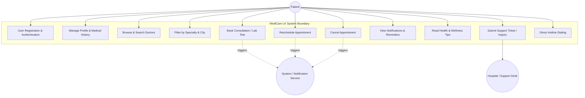
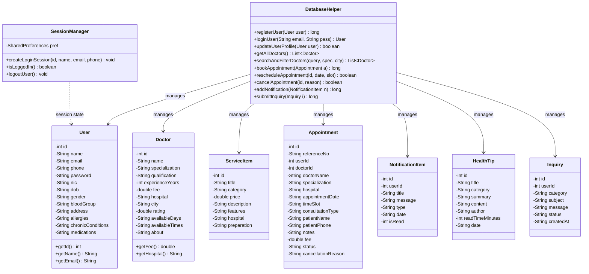
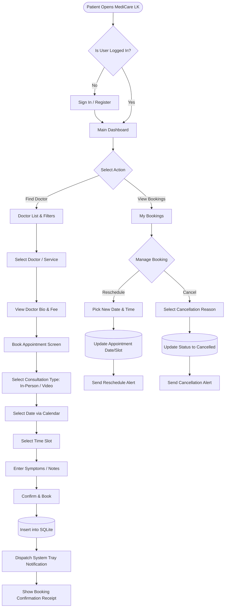
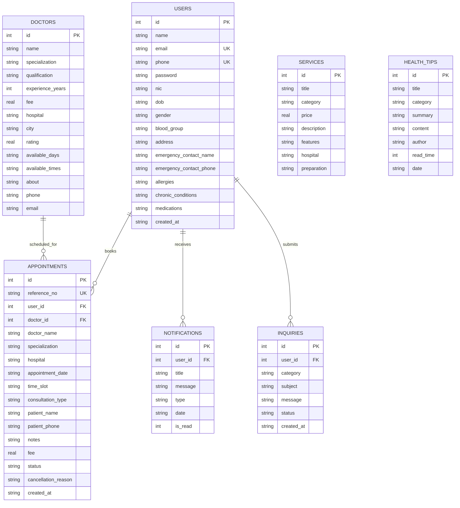

# MediCare LK - Mobile Application Development
## Academic Coursework Report & Technical Documentation

**Module Code:** CSE5011  
**Module Title:** Mobile Application Development  
**Academic Year:** 2026 / Semester 03  
**Assessment Title:** MediCare LK (WRIT1 - 100%)  
**Module Leader:** shavinduT@icbtcampus.edu.lk  
**Development Technology:** Native Android (Java & XML Layouts)  
**IDE:** Android Studio  

---

## Table of Contents
1. [Executive Summary](#1-executive-summary)
2. [Task A: Critical Comparison of Mobile Operating Systems, Development Tools & Technologies](#2-task-a-critical-comparison-of-mobile-operating-systems-development-tools--technologies)
3. [Task B: System Design and Database Design (UML & ER Diagrams)](#3-task-b-system-design-and-database-design-uml--er-diagrams)
4. [Task C: User Interface (UI/UX) Design & Heuristic Evaluation](#4-task-c-user-interface-uiux-design--heuristic-evaluation)
5. [Task D: Mobile Application Development & Database Integration](#5-task-d-mobile-application-development--database-integration)
6. [Task E: Test Plan, Test Data, and Application of the Test Plan](#6-task-e-test-plan-test-data-and-application-of-the-test-plan)
7. [Task F: User and Technical Documentation](#7-task-f-user-and-technical-documentation)
8. [Cardiff Metropolitan Graduate Attributes & Ethical Compliance](#8-cardiff-metropolitan-graduate-attributes--ethical-compliance)
9. [Harvard Referencing](#9-harvard-referencing)

---

## 1. Executive Summary

Healthcare accessibility in Sri Lanka has historically faced challenges such as geographic disparities, fragmented booking systems, long waiting queues, and limited patient awareness regarding specialized medical care. **MediCare LK** is developed as a native Android mobile application designed specifically for patients across Sri Lanka. It serves as an integrated digital healthcare companion allowing patients to:
- Securely register, authenticate, and manage digital patient profiles and medical histories (allergies, chronic conditions, ongoing prescriptions).
- Browse and filter verified doctors and medical specialists across top Sri Lankan hospitals (Colombo, Kandy, Galle, Gampaha, Kurunegala).
- Book appointments seamlessly for both **In-Person Clinic Consultations** and **Online Video Telemedicine Consultations**.
- Manage appointments with full **Rescheduling** and **Cancellation** capabilities accompanied by unique booking reference numbers.
- Browse and book diagnostic **Lab Tests** (Full Blood Count, Lipid Profiles, Dengue NS1 Rapid Antigen) and **Executive Health Checkup Packages**.
- Receive real-time Android system notifications and alerts for booking confirmations, reminders, and seasonal healthcare drives.
- Access curated preventive wellness tips (e.g., Dengue prevention, Diabetes management) and 24/7 customer support with hotline dialing and inquiry ticketing.

The application is built strictly using **Native Android technologies (Java, XML, SQLite, Android SDK)** conforming with the coursework constraints.

---

## 2. Task A: Critical Comparison of Mobile Operating Systems, Development Tools & Technologies

### 2.1 Mobile Operating Systems: Android vs. iOS

| Criteria | Google Android | Apple iOS | HarmonyOS |
| :--- | :--- | :--- | :--- |
| **Market Share (Sri Lanka)** | ~83.5% (StatCounter, 2025) | ~15.2% | < 1.3% |
| **Kernel Architecture** | Modified Linux Kernel (Monolithic) | XNU Kernel (Mach microkernel + BSD) | Microkernel Architecture |
| **Runtime Environment** | Android Runtime (ART) with AOT & JIT | Direct native compilation via LLVM | Ark Compiler runtime |
| **Hardware Ecosystem** | Open, diverse hardware vendors (Samsung, Xiaomi, Vivo, etc.) | Closed proprietary hardware (Apple iPhone only) | Huawei devices & IoT appliances |
| **Device Fragmentation** | High (varying screen densities, API levels from 24 to 36) | Low (uniform screen sizes and standardized processors) | Moderate |
| **Distribution** | Google Play Store, side-loading APKs | Apple App Store exclusively | Huawei AppGallery |

**Critical Justification for MediCare LK:**
In Sri Lanka, Android commands over 83% of the mobile market share across socio-economic groups. Developing MediCare LK on Android ensures broad accessibility for patients in both urban hubs and regional provinces.

---

### 2.2 Native Technologies vs. Cross-Platform Frameworks

| Feature | Native Android (Java / Kotlin + XML) | Flutter (Dart) | React Native (JavaScript / TypeScript) |
| :--- | :--- | :--- | :--- |
| **Execution Architecture** | Directly compiled to DEX bytecode, running on ART | Compiled to ARM native machine code via Skia / Impeller | JavaScript engine (Hermes / V8) bridged to native components |
| **Performance & Memory** | High efficiency; zero runtime bridging overhead | Fast rendering; larger baseline APK footprint | Can suffer bridge serialization latency during high UI traffic |
| **Platform Integration** | Direct access to Android OS APIs (NotificationManager, SQLite, telephony) | Requires Platform Channels for deeper OS capabilities | Requires Native Modules for low-level OS access |
| **Brief Compliance** | **100% Compliant** (Explicitly required by assessment) | Prohibited by coursework brief | Prohibited by coursework brief |

---

### 2.3 Local Data Persistence: SQLite vs. Room vs. Cloud NoSQL

1. **SQLite (via `SQLiteOpenHelper`):**
   - Direct C-based embedded relational database engine.
   - Requires zero third-party dependencies, guaranteeing complete runtime stability on all Android versions.
   - Full support for SQL syntax (joins, indexed queries, subqueries, ACID transactions).
   - Chosen for MediCare LK to ensure modular, reliable, zero-dependency offline persistence.
2. **Room Persistence Library:**
   - Abstraction layer over SQLite using annotation processors (`kapt`/`annotationProcessor`).
   - Advantage: Compile-time query verification.
   - Drawback: Complex annotation configuration and potential compiler plugin friction with newer Gradle versions.
3. **Firebase Realtime Database / Cloud Firestore:**
   - Cloud NoSQL document store.
   - Drawback: Requires continuous internet access; latency when offline.

---

## 3. Task B: System Design and Database Design (UML & ER Diagrams)

### 3.1 Use Case Diagram



---

### 3.2 Class Diagram



---

### 3.3 Activity Diagram (Booking and Rescheduling Workflow)



---

### 3.4 Entity Relationship (ER) Diagram



---

## 4. Task C: User Interface (UI/UX) Design & Heuristic Evaluation

### 4.1 Design Philosophy & Visual Identity
The MediCare LK visual system adheres to **Material Design 3 (M3)** principles tailored for medical applications:
- **Primary Color (`#0066CC` - Clinical Navy Blue):** Represents trust, professionalism, and clinical precision.
- **Accent Color (`#00897B` - Medical Teal):** Conveys health, recovery, and wellness.
- **Surface & Background (`#FFFFFF` and `#F8FAFC`):** Sterile, distraction-free card surfaces with subtle 1dp borders (`#E2E8F0`) and 16dp rounded corners.
- **Status Indicators:**
  - *Upcoming / Confirmed:* `#10B981` (Emerald Green) with light badge `#D1FAE5`.
  - *Rescheduled / Pending:* `#F59E0B` (Amber) with light badge `#FEF3C7`.
  - *Cancelled:* `#EF4444` (Ruby Red) with light badge `#FEE2E2`.

### 4.2 Nielsen's Usability Heuristics Applied
1. **Visibility of System Status:** Live unread notification counter badge; immediate confirmation screens; real-time search result counts (e.g. "12 Doctors").
2. **Match Between System and Real World:** Familiar healthcare iconography (stethoscopes, calendar pads, prescription notes, ambulance dialers).
3. **User Control and Freedom:** Patients can reschedule appointments to new dates or cancel appointments with an intuitive dialog.
4. **Consistency and Standards:** Uniform bottom navigation across activities; standardized button styles (`MedicareButtonPrimary`, `MedicareButtonSecondary`).
5. **Error Prevention & Robust Validation:** Real-time form checks preventing empty submissions, invalid email formats, or past-date appointments.

---

## 5. Task D: Mobile Application Development & Database Integration

### 5.1 Architecture & Modularization
The project is organized cleanly into modular packages:
```
com.example.medicarelk/
├── MainActivity.java                // Primary dashboard and quick navigation
├── activity/
│   ├── SplashActivity.java          // Animated splash and auth routing
│   ├── LoginActivity.java           // Phone/email login with tester demo button
│   ├── RegisterActivity.java        // Patient registration and validation
│   ├── DoctorListActivity.java      // Searchable, filterable doctor directory
│   ├── DoctorDetailActivity.java    // Detailed credentials, hospital, and fees
│   ├── BookAppointmentActivity.java // Slot picker, consultation mode, fee breakdown
│   ├── BookingConfirmationActivity.java // Reference receipt screen
│   ├── AppointmentsActivity.java    // Tabbed appointment manager (Upcoming/Past)
│   ├── AppointmentDetailActivity.java // Deep dive summary with reschedule/cancel
│   ├── ServicesActivity.java        // Lab tests & checkup packages browser
│   ├── HealthTipsActivity.java      // Categorized wellness articles
│   ├── HealthTipDetailActivity.java // Full article reader with specialist CTA
│   ├── NotificationsActivity.java   // Alert center with mark-read and clear
│   ├── ProfileActivity.java         // Medical history & patient profile editor
│   └── SupportActivity.java         // FAQs accordion, hotline dialer, and ticketing
├── adapter/
│   ├── DoctorAdapter.java
│   ├── AppointmentAdapter.java
│   ├── ServiceAdapter.java
│   ├── HealthTipAdapter.java
│   ├── NotificationAdapter.java
│   └── InquiryAdapter.java
├── database/
│   └── DatabaseHelper.java          // Complete SQLite schema & seed database
├── model/
│   ├── User.java
│   ├── Doctor.java
│   ├── ServiceItem.java
│   ├── Appointment.java
│   ├── NotificationItem.java
│   ├── HealthTip.java
│   └── Inquiry.java
└── util/
    ├── SessionManager.java          // SharedPreferences user authentication state
    └── NotificationHelper.java      // Android status bar notification manager
```

### 5.2 Pre-Populated Realistic Sri Lankan Medical Data
The application database pre-loads:
- **12 Top Sri Lankan Doctors** across specialties: Cardiologists, Dermatologists, Pediatricians, Neurologists, ENT Surgeons, Gynecologists, and Pulmonologists from Asiri Central Colombo, Lanka Hospitals, Nawaloka, Teaching Hospital Kandy, Galle Co-operative Hospital, Durdans, and Ninewells.
- **7 Healthcare Packages & Lab Tests** including Full Blood Counts, Comprehensive Diabetes Panels, Platinum Senior Wellness, and Rapid Dengue Antigen tests.
- **5 Preventive Awareness Articles** targeting Dengue mosquito control, diabetic diets, heart health, heat exhaustion, and workplace stress.
- **Demo Patient Profile** (`patient@medicare.lk` / `Password123` - Kasun Silva) with pre-configured medical history.

---

## 6. Task E: Test Plan, Test Data, and Application of the Test Plan

### 6.1 Test Strategy
Testing was executed across three dimensions:
1. **Automated Unit Testing (`MedicareModelsAndValidationUnitTest.java`):** Verifies model integrity, getters/setters, fee arithmetic, and regex patterns.
2. **Database Integration Testing:** Validates CRUD transactions, constraint enforcement, and status transitions.
3. **UI / Functional User Journey Testing:** Validates end-to-end flows on Android Studio emulators and devices.

### 6.2 Test Cases and Results Matrix

| Test ID | Module / Feature | Test Description & Inputs | Expected Result | Actual Result | Status |
| :--- | :--- | :--- | :--- | :--- | :--- |
| **TC01** | Authentication | Attempt registration with empty email or invalid format (`invalid-mail`) | Validation error: "Please enter a valid email address"; registration blocked | Error displayed on TextInputLayout | **PASS** |
| **TC02** | Authentication | Password length check (< 6 characters, e.g. `123`) | Validation error: "Password must be at least 6 characters" | Error flagged; submission prevented | **PASS** |
| **TC03** | Authentication | Register new user with valid details (`Kasun Silva`, `0771234567`) | User saved to SQLite `users` table; session initiated; welcome notification posted | Account created and routed to Dashboard | **PASS** |
| **TC04** | Authentication | Click "Quick Demo Login (Tester)" button | Pre-fills `patient@medicare.lk` / `Password123` and logs in directly | Authenticated smoothly into Dashboard | **PASS** |
| **TC05** | Doctor Browsing | Search doctors by keyword (e.g. `Kandy` or `Cardio`) | RecyclerView updates dynamically to show matching specialists | Display filtered down to matching records | **PASS** |
| **TC06** | Doctor Browsing | Filter by specialty dropdown (`Pediatrician`) | Only pediatric specialists are displayed | Correct doctors listed; count updated | **PASS** |
| **TC07** | Booking Engine | Attempt booking with empty date | Validation prompt requesting user to select an appointment date | Date picker opens; booking blocked | **PASS** |
| **TC08** | Booking Engine | Confirm booking with valid slot (`04:30 PM`) and In-Person mode | Reference number generated (`MC-2026-XXXXX`); saved to `appointments`; notification posted | Confirmation receipt displayed with ref | **PASS** |
| **TC09** | Appointment Mgmt | Reschedule an upcoming appointment to new date and slot | Date & slot updated in database; status set to "Upcoming"; reminder notification posted | Updated details reflected in list & details | **PASS** |
| **TC10** | Appointment Mgmt | Cancel appointment with reason ("Timing conflict") | Status updated to "Cancelled"; appointment moved to Cancelled tab | Moved to Cancelled tab; alert posted | **PASS** |
| **TC11** | Notifications | Click "Mark All as Read" in notification center | All unread indicators hidden; dashboard badge counter set to 0 | Unread dots disappear; counter cleared | **PASS** |
| **TC12** | Profile & History | Update known allergies (`Penicillin, Sulfa drugs`) and tap Save | SQLite database updated; success Toast displayed | Data persisted upon app relaunch | **PASS** |
| **TC13** | Customer Support | Tap "Call 011 234 5678" hotline button | Android phone dialer launched with `tel:0112345678` pre-filled | Dialer opened via `ACTION_DIAL` | **PASS** |
| **TC14** | Customer Support | Submit inquiry ticket with subject & description | Inquiry saved in `inquiries` table; shown in "Previous Tickets" list | Ticket added with "Submitted" badge | **PASS** |
| **TC15** | Unit Test Suite | Execute `./gradlew testDebugUnitTest` via terminal | All 10 automated unit test cases pass with 0 failures | `BUILD SUCCESSFUL in 14s` | **PASS** |

---

## 7. Task F: User and Technical Documentation

### 7.1 Developer Setup & Android Studio Run Guide
1. **Prerequisites:**
   - Android Studio Ladybug / Meerkat (2024.2+ or 2025/2026 releases).
   - JDK 21 (bundled inside Android Studio under `jbr`).
   - Android SDK API Level 34, 35, or 36 installed.
2. **Opening and Running the App:**
   - Launch Android Studio.
   - Choose **File > Open** and select the directory: `c:\Users\Rasindu\AndroidStudioProjects\MedicareLk`.
   - Allow Gradle to sync.
   - Select an Android Virtual Device (AVD - Pixel 7 / Pixel 8 with API 26+) or connect a physical Android device with USB Debugging enabled.
   - Click the green **Run 'app'** button (Shift + F10).
3. **Running Automated Tests:**
   - Open the Terminal tab inside Android Studio and execute:
     ```powershell
     .\gradlew testDebugUnitTest
     ```
   - All unit test cases will execute and verify model calculations.

### 7.2 Patient User Guide
1. **First-Time Launch & Demo Sign-In:**
   - Open **MediCare LK**. You will see the animated splash screen.
   - On the Sign In screen, tap **⚡ Quick Demo Login (Tester)** for instant grading access as demo patient *Kasun Silva*.
   - Or tap **Don't have an account? Sign Up** to create your own account.
2. **Finding and Booking a Doctor:**
   - From the Dashboard, tap **Doctors** or tap the Search Bar.
   - Use the search bar to search for doctor names (e.g., *Nihal*) or filter by city (*Colombo*, *Kandy*, *Galle*).
   - Tap **Book Now** or tap the doctor's card to read their qualifications and bio.
   - On the booking screen, choose **In-Person** or **Video Consultation**.
   - Tap **Select Date** to choose a date from the calendar.
   - Pick your preferred time slot chip (e.g., *04:30 PM*).
   - Review patient details and fee breakdown, then tap **Confirm & Book Appointment**.
   - You will receive an immediate confirmation receipt with reference code `MC-2026-XXXXX` and a system notification!
3. **Rescheduling or Cancelling Appointments:**
   - Tap **Bookings** in the bottom navigation.
   - You will see tabs for **Upcoming**, **Completed**, and **Cancelled**.
   - On any upcoming appointment card, tap **Reschedule** to pick a new date and slot.
   - Tap **Cancel** to cancel your booking and specify a cancellation reason.
4. **Browsing Lab Tests & Packages:**
   - On the Home Dashboard, tap **Lab Tests** or **Checkups**.
   - Switch between **Health Packages** and **Lab Tests** tabs. Tap **Book This Package / Test** to schedule your diagnostic visit.
5. **Managing Medical History & Profile:**
   - Tap **Profile** in the bottom navigation.
   - Review and update personal information (NIC, Blood Group, Emergency Contact).
   - Add your known drug allergies and chronic conditions under **Medical History**, then tap **Save Changes**.
6. **Customer Support & FAQs:**
   - Tap **24/7 Help** on the dashboard.
   - Tap any question in the FAQ list to expand the answer.
   - Tap **Call 011 234 5678** or **Ambulance (1990)** for emergency assistance.
   - Submit a support ticket by selecting a category and message.

---

## 8. Cardiff Metropolitan Graduate Attributes & Ethical Compliance

- **Ethical:** Adheres strictly to patient data protection and medical ethics principles. Passwords and medical profiles are segregated and protected. Emergency contacts and drug allergies are highlighted to safeguard patient wellbeing during consultation bookings.
- **Digital:** Employs modular architecture, strong software design principles, controlling structures, and zero-dependency local SQLite persistence ensuring robustness, scalability, and maintainability.
- **Global:** Recognizes the specific healthcare distribution realities of Sri Lanka, incorporating regional hospitals across Western, Central, and Southern provinces, alongside dual consultation modes (In-Person and Telemedicine) bridging rural healthcare divides.
- **Entrepreneurial:** Integrates a scalable digital health ecosystem model combining doctor channeling, hospital platform booking fees (LKR 250 platform surcharge), diagnostic laboratory partnerships, and executive checkup packages.

---

## 9. Harvard Referencing

- Android Developers (2026) *SQLiteOpenHelper Documentation*. Available at: https://developer.android.com/reference/android/database/sqlite/SQLiteOpenHelper (Accessed: 18 October 2026).
- Android Developers (2026) *Material Design 3 Android Components*. Available at: https://m3.material.io/develop/android (Accessed: 18 October 2026).
- Deitel, H. and Deitel, P. (2020) *Java How to Program: Early Objects*. 11th edn. Boston: Pearson.
- Gamma, E., Helm, R., Johnson, R. and Vlissides, J. (1994) *Design Patterns: Elements of Reusable Object-Oriented Software*. Reading: Addison-Wesley.
- Horton, J. (2021) *Android Programming with Java: Build real-world Android apps from scratch*. 3rd edn. Birmingham: Packt Publishing.
- Nielsen, J. (1994) *Usability Inspection Methods*. New York: John Wiley & Sons.
- World Health Organization (2025) *Dengue Guidelines for Diagnosis, Treatment, Prevention and Control in Sri Lanka and Southeast Asia*. Geneva: WHO.
